<p align="center">
  
</p>

<p align="center">
  <a href="https://www.linkedin.com/in/victordmnzs/"></a>
  
  
</p>

```console
victor@netsec:~$ whoami
Network Engineering student at UFSM, working with network & cybersecurity at Forte Security.
I build labs, break them on purpose, and document what I learn.

victor@netsec:~$ cat goals.txt
> Network Engineer specializing in cybersecurity
```

## `~/projects`

| Repo | Area | What's inside |
|---|---|---|
| [**wazuh-hids-lab**](https://github.com/Victordmnzs/wazuh-hids-lab) | `blue team` `detection` | Wazuh Manager + Agent, 11 custom rules (FIM, SSH brute force, SQLi, XSS, LFI, port scan) and a custom UFW decoder, each validated with a controlled attack |
| [**ldap-centralized-auth**](https://github.com/Victordmnzs/ldap-centralized-auth) | `IAM` `hardening` | OpenLDAP with Linux (NSS/PAM) and Windows (pGina) clients, group-based sudo and slapd/auth.log analysis |
| [**dynamic-routing-protocols-network**](https://github.com/Victordmnzs/dynamic-routing-protocols-network) | `routing` `switching` | Multi-site hub-and-spoke network: VLSM, VLANs, PVST+, Frame Relay, OSPF + RIPv2 redistribution and eBGP |

## `~/certifications`

```diff
+ Sophos Firewall Engineer v22.0
+ Cloud Tech Professional – Advanced EDR
+ Cloud Tech Professional – Advanced Backup
+ Sophos Firewall Architect v22.0
+ MikroTik Certified Network Associate (MTCNA)
```

## `~/stack`

<p>
  
  
  
  
  
  
  
  
  
  
</p>

## `~/off-keyboard`

```console
victor@netsec:~$ uptime --hobbies
basketball player 🏀
```

<details>
<summary><b>🇧🇷 Em português</b></summary>

<br>

```console
victor@netsec:~$ whoami
Estudante de Redes de Computadores na UFSM, atuando com redes e segurança na Forte Security.
Monto laboratórios, quebro de propósito e documento o que aprendo.

victor@netsec:~$ cat objetivo.txt
> Engenheiro de Redes especializado em cibersegurança
```

| Repositório | Área | O que tem |
|---|---|---|
| [**wazuh-hids-lab**](https://github.com/Victordmnzs/wazuh-hids-lab) | `blue team` `detecção` | Wazuh Manager + Agent, 11 regras customizadas (FIM, força bruta SSH, SQLi, XSS, LFI, port scan) e decoder próprio para UFW, cada uma validada com ataque controlado |
| [**ldap-centralized-auth**](https://github.com/Victordmnzs/ldap-centralized-auth) | `IAM` `hardening` | OpenLDAP com clientes Linux (NSS/PAM) e Windows (pGina), sudo por grupo e análise de logs do slapd e auth.log |
| [**dynamic-routing-protocols-network**](https://github.com/Victordmnzs/dynamic-routing-protocols-network) | `roteamento` `switching` | Rede multi-site hub-and-spoke: VLSM, VLANs, PVST+, Frame Relay, redistribuição OSPF + RIPv2 e eBGP |

**Certificações:** Sophos Firewall Engineer v22.0 · Cloud Tech Professional – Advanced Backup

</details>
